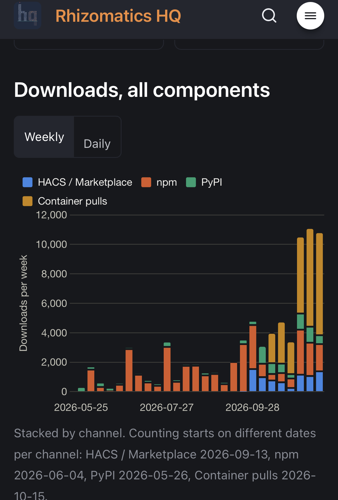

[](https://github.com/rhizomatics) [](https://hq.rhizomatics.org.uk/) [](https://www.npmjs.com/package/@rhizomatics/hq-stats)
[](https://www.npmjs.com/package/@rhizomatics/hq-stats)
[](https://github.com/rhizomatics/hq-stats/blob/main/LICENSE)

# hq-stats

Usage stats for open source projects, from every channel they publish to, with public pages or raw JSON.
No AI, no cookies, no accounts beyond the tokens you already have. Support for common tools and registries such as GitHub, PyPi, NPMJS and GoatCounter, and specific support for **Home Assistant** and **SignalK** developers.

Designed as part of [HQ](https://hq.rhizomatics.org.uk/usage/), a central management repo for developing multiple open source projects, although usable independently.

- **Downloads**: PyPI, npm, GitHub Container Registry, Home Assistant Marketplace (previously known as HACS),release downloads
- **Installs**: Home Assistant's public analytics for custom integrations
- **GitHub**: stars, repo page views and clones (GitHub keeps 14 days; hq-stats snapshots them daily so they're kept)
- **Websites**: page views from [GoatCounter](https://www.goatcounter.com/), which needs no cookie banner
- **Platform ratings**: Home Assistant's Integration Quality Scale (the level each integration declares, and the
  level its own `quality_scale.yaml` adds up to) and the SignalK plugin registry's score, badges and test status
- **Community**: projects other people build on yours (plugins, cards, add-ons), from their public figures only,
  shown on their own page and never added to your totals

See it in context at the [Rhizomatics HQ](https://hq.rhizomatics.org.uk/usage/), with the page views and downloads across all of the supported page analytics and download types. Use it as part of your own HQ, integrate the results pages into your own site, or just use the JSON results for your own analytics. It works fine with a personal GitHub account, or a GitHub organization.



## How it works

1. You list your products in `products.toml`, each with its repos and the artefacts it publishes (a PyPI
   package, a container image, a website...), and your org in `hq.toml`.
2. A scheduled GitHub Actions workflow runs `hq-stats collect` once a day and commits a snapshot
   (`data/stats/YYYY-MM-DD.json`) to your repo.
3. `hq-stats build` turns the snapshots into one public aggregate, `stats.json`.
4. Show it with the built-in pages (an Astro/Starlight integration, publishable on GitHub Pages), or use
   `stats.json` in your own pages.

Everything is assumed public: private repos are skipped, and nothing beyond counts is stored (no referrers, no
visitor details). If you want your figures private, keep the repo holding them private.

## Set up

### Configuration

Two files, plus an optional third, in the same directory (the repo's root, usually):

```toml
# hq.toml: the org, and optionally stats settings and product lines
[org]
github = "my-org" # GitHub org, or your own user name, that owns the repos
name = "My Org" # display name

[stats] # optional; paths relative to this file
data_dir = "data/stats" # snapshots (default)
out = "data/stats.json" # the aggregate `build` writes (default: next to data_dir)

[lines.libraries] # optional: product lines, the headings products are listed under, in display order
name = "Libraries"

[lines.org]
name = "Organisation"
kind = "org" # your own sites: shown under page views only, never counted as products
```

```toml
# products.toml: one table per product, keyed by its slug
[my-library]
line = "libraries"
significance = "major" # optional
artefacts.pypi = "my-library" # PyPI package
artefacts.npm = "@my-org/my-lib" # npm package
artefacts.ghcr = "my-image" # container image under ghcr.io/<org>/
artefacts.homeassistant_marketplace_integration = { asset = "my_integration.zip", domain = "my_integration" }
artefacts.website = { goatcounter = "my-library-docs" } # GoatCounter site code for its website

[homepage]
line = "org"
repos = [".github"] # the repos it's built in; default: the slug
artefacts.website = { goatcounter = "my-org" }
```

```toml
# community.toml (optional): projects other people build on yours, one table each
[my-library-card]
repo = "someone/my-library-card" # owner/name on GitHub
author = "someone" # GitHub login (default: the repo's owner)
extends = "my-library" # which of your products it builds on
# relation = "recommended" # optional: someone else's project you recommend using with it, rather than built on it
artefacts.homeassistant_marketplace_frontend = { asset = "my-library-card.js" }
```

**Products** are what users install or visit. The slug is the product's name in the pages (`/usage/<slug>/`)
and defaults to its repo's name; a product built in several repos lists them in `repos`, and its GitHub figures
are summed. Each repo belongs to one product. Other fields: `description` (used until the first snapshot has one),
`lifecycle` (`active`, the default; `experimental`, not counted as a product site; `archived`, left off the
pages), `public = false` (left out), `platform` (what it runs on, e.g. `homeassistant`; a line can set a default
and an artefact can override it).

**Artefacts** are how a product is delivered, keyed by name. The name is also the distribution unless the artefact
says `distribution =`, so a product with two of a kind names them (`firmware`, `daemon`). A string is the
package name. hq-stats counts these distributions and ignores any others:

| Distribution                            | Fields                                 | Counted                                          |
| --------------------------------------- | -------------------------------------- | ------------------------------------------------ |
| `pypi`, `npm`                           | `package`                              | downloads                                        |
| `ghcr`                                  | `package`: the image under ghcr.io/org | pulls                                            |
| `homeassistant_marketplace_integration` | `asset`, `domain`                      | HACS downloads of the release asset; HA installs |
| `homeassistant_marketplace_frontend`    | `asset` (a card's `.js`)               | HACS downloads of the release asset              |
| `website`                               | `goatcounter`: the site code           | page views                                       |

A product that's been renamed keeps its history with `formerly`. Each field takes one name or a list:

- `formerly = { name = "old-repo" }` on the product: the repo's name before the rename. Snapshots from before
  then are read under the new one.
- `formerly = { asset = "old_name.zip" }` on an artefact: the release asset's old name. Older releases keep it, so
  both are counted. Likewise `package` (the old package's downloads are added) and `domain` (its installs are).

Community projects are collected from public sources only (stars, releases, downloads; no traffic, which only
their authors can see), stored under `community` in the snapshots and the aggregate, and shown on a Community page.
Entries with `kind = "blog"`, or without a `repo`, are ignored, so the file can list other things too.

Anything else in the files is left alone, so they can hold your own settings too.

### From repos.toml

Before 0.3.0 the configuration was one `repos.toml`. It's still read, with a notice, until at least 1.0 and not
before 2027-06-01. `hq-stats migrate` writes the new files from it, next to it (or `--out <dir>`): families become
lines (`meta` a line with `kind = "org"`), `upstream` becomes `platform`, `category` becomes `significance`,
`lifecycle` and `public`, and the channel fields become artefacts. Comments aren't carried over. Check the files,
then delete `repos.toml`: `hq.toml` is read first once it exists. Snapshots and page URLs don't change, except a
repo whose name isn't a valid slug (`.github` becomes `github`; rename it as you like with `repos`).

### Tokens

- `GITHUB_TOKEN`: a fine-grained token for your repos with **Metadata: read** and **Administration: read**
  (GitHub's traffic API needs the latter). Create it under the organisation as resource owner, or your own account
  for personal repos. Locally, a logged-in `gh` CLI works too.
- `GOATCOUNTER_TOKEN` (optional): a GoatCounter API key with **Read statistics**.

### Daily workflow

Copy [examples/collect-stats.yml](examples/collect-stats.yml) to `.github/workflows/` in the repo with your
`hq.toml`, and add the secrets it names (as `STATS_TOKEN` and `GOATCOUNTER_TOKEN`). It runs on a schedule and
by hand, never on pull requests. Run it once by hand to check: it commits `data/stats/<today>.json` and
`data/stats.json`.

GitHub only keeps 14 days of traffic, so history starts with your first snapshot; download counters that only
give a lifetime total (HACS, GHCR) show daily figures from the second.

### Pages

In an Astro site with [Starlight](https://starlight.astro.build/):

```js
// astro.config.mjs
import starlight from "@astrojs/starlight";
import hqStats from "@rhizomatics/hq-stats/astro";
import { usageSidebar } from "@rhizomatics/hq-stats/sidebar";

const options = { config: ".." }; // the directory with hq.toml; also: stats (path to stats.json), base (default 'usage')

export default defineConfig({
  integrations: [starlight({ title: "My Org", sidebar: [{ label: "Usage", items: usageSidebar(options) }] }), hqStats(options)],
});
```

Run `hq-stats build` before `astro build`. The pages are mounted at `/usage/` (Downloads), `/usage/page-views/`,
`/usage/<product>/` and, when there are community projects, `/usage/community/`. They need `chart.js`
installed alongside.

For a site with nothing else, copy [examples/standalone](examples/standalone) to `site/` next to your
`hq.toml`, set `site` (and `base`, for a project site such as `https://<owner>.github.io/<repo>/`) in its
`astro.config.mjs`, and run `npm install` there. To publish it on GitHub Pages, copy
[examples/publish-stats.yml](examples/publish-stats.yml) to `.github/workflows/` and set Pages' source to
"GitHub Actions" in the repo's settings.

The standalone example uses the hq-stats logo and colours (`@rhizomatics/hq-stats/brand/logo.svg`,
`@rhizomatics/hq-stats/theme.css`); swap in your own logo and drop `theme.css` to use your colours. Chart colours
are CSS variables (`--viz-1` … `--viz-4`, `--viz-text`, …) you can override in your own CSS.

### Raw data

`stats.json` is documented in [docs/data-format.md](docs/data-format.md), and so are the daily snapshots. Both are
versioned with the package; a breaking change to either is a major version.

## Commands

```text
hq-stats collect   snapshot every public repo of every product (run daily)
hq-stats build     write stats.json from the snapshots
hq-stats migrate   write hq.toml, products.toml and community.toml from a repos.toml

  --config <path>   the directory with hq.toml, or a repos.toml
                    (default: $HQ_CONFIG, $REPOS_TOML, then . and ..; hq.toml before repos.toml)
  --data <dir>      snapshot directory
  --legacy <file>   history from the retired hacs-downloads site, if you have it
  --out <path>      where build writes stats.json; where migrate writes the new files
  --offline         build from snapshots only, without live npm, PyPI and Home Assistant calls
  --force           migrate over existing files
```

## What the numbers mean

None of the counters counts people. Downloads include updates, CI and mirrors; Home Assistant installs only cover
installations that opted in to analytics; GitHub's traffic includes bots; GoatCounter counts one view per page per
visitor session. The pages say this next to each figure.

## Licence

Apache 2.0.
